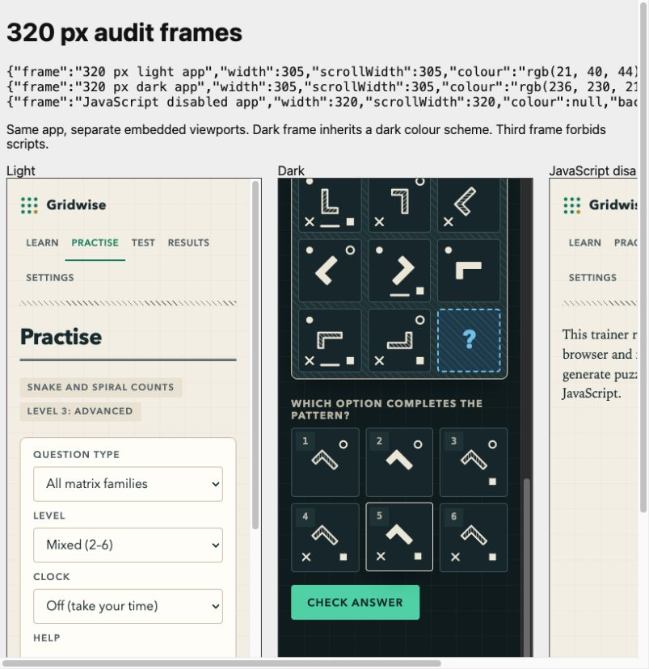

# Gridwise adversarial review — 27 October 2026

Baseline: `9b16815`. Node 26.8.2. The baseline passed **329 tests**. Passing the
original suite did not establish the advertised uniqueness or copy accuracy.

The fixes retain the static engine → render → app architecture. No dependencies,
build step, runtime network calls, analytics or affiliation claims were added.
New accepted matrix readings were added to **both** solvers; the original
in-grammar uniqueness checks remain in force. Reverse set readings that cannot
uniquely predict a set still exclude any competing *offered* option they satisfy.

## Ranked findings and reproductions

P1 = a valid answer can be marked wrong. P2 = misleading teaching, answer leakage,
state corruption or inaccurate claims. P3 = narrower robustness/content issue.
Indices below are zero-based. Reproductions refer to pre-fix code; rejection changes
make some seeds generate a different puzzle now. Frozen fixtures preserve the
exact matrix evidence in the current checkout.

| Severity | File | Family / level / seed or route | Reproduction and result | Status |
|---|---|---|---|---|
| P1 | `src/engine/global.js`, both solvers | `split`, 1, `audit-18` | Counts `4 3 4 / 2 3 2 / 3 2 ?`: tally answer 4; option 3 also obeys first=last in every row. | Fixed: endpoint-mirror readings and generator rejection; frozen numeric-grid regression. |
| P1 | `src/engine/composite.js`, `generate.js`, both solvers | `composite`, 1, `audit-0` | Correct figure with marks `[ring,square]` (old option 5) obeys **middle = bottom minus top** in every column; intended option 0 has `[dot,ring,cross,square]`. QA had discounted reverse operations as weak. | Fixed: reverse operations are strong in QA and conflicting options are filtered by the generator. Fixture `composite-1-audit-0.json`. |
| P1 | both solvers | `rotation`, 1, `audit-185` | Angles in 45° units: `1 1 0 / 2 2 1 / 3 3 ?`. Intended 2, but option 0 has 1: top + middle = bottom in each column, modulo a turn. | Fixed: modular angle addition in both solvers. Fixture `rotation-1-audit-185.json`. |
| P1 | `cells.js`, both solvers | `mirrorRows`, 1, `audit-0` | Rotations `6 2 2 / 0 4 4 / 2 6 ?` advance 90° down columns. Reflections `0 0 1 / 0 0 1 / 0 0 ?` admit XOR, giving unreflected rather than reflected at the same 270° angle (old option 4). | Fixed: reflection XOR in both solvers, rejection before acceptance. Fixture `mirrorRows-1-audit-0.json`. |
| P1 | `src/engine/items/logic.js` | `logic`, 1, `audit-12` | “All pilots have a licence; Amir is a pilot” offered both “Amir has a licence” and the definitional truth “A glider pilot is a pilot”. The formal checker ignored the unparsed option. | Fixed the tautological bank distractor; added regression. Unparsed world-knowledge distractors still require semantic review. |
| P1 | `src/engine/items/wordbank.js` | `vocab`, 3, `audit-491` | “Entering the data by hand was ____, but it had to be done”: both **tedious** and **arduous** fit naturally. | Fixed: easy, dull, unvarying repetition is now explicit; demonstrated alternatives excluded. |
| P2 | `global.js`, `tools/qa-report.js` | `invariant`, 6, `audit-0`; `composition`, 6, `audit-3` | Old global majority probe compared distinct whole-cell keys, so it always tied. Per-shape/fill-count voting picked the answer in **850/1,000 invariant** and **234/1,000 composition** level-6 puzzles. | Fixed probe and generator rejection. Preserved invariant fixture and independent voting tests. |
| P2 | `global.js` | `mirrorRows`, 6, `audit-184` | Option reflections were `[0,0,1,0,0,0]`; only the answer (2) was reflected. | Fixed: require another option with the answer's handedness. Fixture retained. |
| P2 | `generate.js` | `addition`, 6, `audit-1`, during this audit | Filtering reverse-operation alternatives left five options with a middle-right dot and the answer without it. This was a regression introduced by the stronger filter, not attributed to the baseline. | Fixed: no set element's presence **or absence** may single out the answer. A second gate rejects unique per-element vote winners (e.g. `union/6/qa-4` before the final gate). Tested all set families/levels. |
| P2 | `src/app/storage.js` | `#/settings`, `#/test`, `#/results` | With an existing saved clock of 30, make writes throw; save 60, then read: old 30 won over the fallback. Failed removals likewise resurrected values. Valid JSON such as `[null]` crashed record consumers; `testFormat:'test'` could self-redirect. | Fixed pending-write/removal shadowing, settings whitelist and loaded-record/session validation. Regression uses a throwing storage adapter. Fallback is still lost on browser reload. |
| P2 | `session.js`, `challenge.js`, `mocktest.js`, `main.js` | `#/challenge/run`, `#/timed/run`, `#/mock/run` | Submit after the absolute deadline but before the next 250 ms timer callback. Deterministic reproduction: mixed challenge at time 0, answer at **30,001 ms** was recorded; mock/timed accepted at 60,001 ms. | Fixed deadline checks in state functions, with late challenge answers discarded rather than assigned to the next item. Clock-injected regression. |
| P2 | `src/engine/items/series.js` | `series`, 1/4/5, `audit-2`; level 5 `audit-1` | Next-step prose was one ahead: e.g. `8,10,13,17,22 → 28` said “+7”, not +6. Growing, square and prime differences were affected. Exponent-pair templates never appeared in 1,000 level-4 seeds because their intended continuation used the wrong base. | Fixed calculations; regression verifies differences and template reachability. |
| P2 | `src/engine/items/logic.js` | `logic`, 3, `audit-1`; `logic-14`; level 5 `logic-4` | A positive consequent was labelled denying the antecedent; universal “all” versus “no” was called contradictory even with an empty subject; an impossible intermediate conditional conclusion was said to “may well be true”. | Fixed and checked against models/truth tables. Universal, existential and one-way conditional wording made explicit. |
| P2 | `src/app/content.js`, `ui.js` | `#/intro` | `combination/1/intro13` described growing triangle counts and alternating fill; actual active rules were size and reflection. `union/1/intro0` claimed a shared top line absent in input 1. `number/1/intro6` described 1–3 diamonds; actual square counts were 1,2,5. Other stale examples included rotation and `intro17`. | Fixed by rendering the engine explanation alongside every generated example. Removed hard-coded seed narration; corrected direction and neighbour-copy advice. All eight matrix and ten item examples tested. |
| P2 | `explain.js`, README, RULES, VERIFICATION, CONTRACTS | All level-6 coupled figures; split/composition levels 1–6 | Coupled attributes were said to have “no pattern of their own” and simultaneously to work “independently”. All 1,000 level-6 samples in each ordinary figure family admitted a strong independent target reading. Split and composition do not gain structural complexity across levels. Counts, family lists and QA denominators were stale. | Corrected claims, not disguised by relabelling the measurements. See difficulty table below. |
| P3 | `src/engine/items/word.js` | `word`, 5, `audit-17` | Options “6:32” and “6:32 and 0/11 min” denote the same time. | Fixed normalisation before deduplication; independently parsed 1,000 seeds and checked every offered overlap time. |
| P3 | `src/engine/items/wordbank.js` | `analogy`, 4, `audit-47` and `audit-98` | Candela was paired with luminosity. | Changed to luminous intensity; kilogram pair changed from weight to mass. [BIPM's base-unit table](https://www.bipm.org/en/measurement-units/si-base-units) supports both terms. |
| P3 | `src/app/routes.js`, `main.js` | `#/intro/%` | Navigate from practice: uncaught `URIError: URI malformed`, old screen remains under the new URL. | Fixed safe URL decoding; browser now shows Page not found, regression added. |
| P3 | `session.js`, `mocktest.js`, `challenge.js` | Adjacent mock slots 17/18; logic level 3 seeds `2tjy89`, `hzx249` | Both generated the universal template. Complete captured session is in `repeated-template.json`; deterministic pair `variety-1`/`variety-2` also reproduces it. | Added bounded deterministic seed reroll for adjacent logic templates, preserving family/level and persisting the chosen seed. Not a guarantee against broader thematic repetition. |

The candela correction is a terminology defect, not evidence of a second defensible
answer. The clock duplication is likewise two equivalent wrong options, not two
correct overlap times. Those distinctions matter.

## Formal logic scope

`SEEDS=1000 node --test tests/logic.test.js` checks 6,000 items. Classes use every
assignment over a three-element domain; named individuals are singleton members.
Universals are evaluated both with and without subject existence. A further
“some” reading is true when its subject is empty, otherwise requiring a witness;
this removes existential force without treating “some” as an arbitrary universal.
The four combinations each leave exactly the intended offered conclusion entailed,
or no offered conclusion when NONE is correct. This is bounded model evidence;
it is not a proof over every domain size or every philosophical reading of “some”.

Conditional items use truth tables; ordering items enumerate all consistent
permutations. Folded “X taller than Y, but shorter than Z” clauses are parsed using
both actual adjectives. Tests check every named option occurs in the statements,
the declared person count, and second/last place from the correct end. Semantic
premise restatements are rejected for class statements; direct conditional premises
are not offered as options. NONE uses one exported constant everywhere.

UI wording now says rules have no exceptions, “some” means at least one (possibly
all), and if–then is one-way: its result may occur without its condition. These
instructions resolve the intended English semantics; they do not prove that all
readers will follow them. No new wrong-answer conclusion was found under the
four tested quantified readings after the fixes.

## Difficulty measurements

Measured with `node tools/adversarial-sweep.js 1000`: 1,000 seeds at each of 138
family/level combinations. Raw data is in `adversarial-measurements.json`.

* **Rule count** is the engine's declared count. It can compress a compound global
  mechanism into one rule, so it is only a proxy, not a calibrated complexity score.
* **Option similarity** is the mean fraction of matching properties across the
  five wrong options; sets compare membership and multi-shape cells compare
  shape/fill multiplicities. Higher similarity means less visual separation, not
  necessarily more reasoning. Raw orientation values are used, so this is not a
  full perceptual model. Compare within families, not across cell kinds.
* **QA confidence** is a pattern-library score. Mostly saturated at 1, it fails as
  a human time-to-solve estimate; composition's lower score does not make it
  psychometrically harder.
* **Singleton properties** are reported as warning signals, not automatically
  defects: all distinct count options make the correct count a singleton. The
  demonstrated five-versus-one reflection and set-element leaks were fixed.

| Family | Mean rule count, levels 1→6 | Mean wrong-option similarity, levels 1→6 | No increase in rule count |
|---|---|---|---|
| rotation | 1, 2, 3, 4, 5, 5 | 0.869, 0.837, 0.838, 0.838, 0.838, 0.836 | 5→6 |
| reflection | 1, 2, 3, 4, 5, 5 | 0.820, 0.820, 0.833, 0.835, 0.836, 0.834 | 5→6 |
| number | 1, 2, 3, 4, 5, 5 | 0.851, 0.836, 0.837, 0.837, 0.838, 0.836 | 5→6 |
| size | 1, 2, 3, 4, 5, 5 | 0.840, 0.837, 0.838, 0.838, 0.838, 0.837 | 5→6 |
| position | 1, 2, 3, 4, 5, 5 | 0.840, 0.836, 0.838, 0.838, 0.838, 0.836 | 5→6 |
| fill | 1, 2, 3, 4, 5, 5 | 0.840, 0.837, 0.838, 0.838, 0.838, 0.837 | 5→6 |
| alternation | 1, 2, 3, 4, 5, 5 | 0.840, 0.837, 0.838, 0.838, 0.838, 0.836 | 5→6 |
| cyclic | 1, 2, 3, 4, 5, 5 | 0.840, 0.837, 0.838, 0.838, 0.838, 0.838 | 5→6 |
| addition | 1, 1, 1, 1, 1, 1 | 0.398, 0.400, 0.405, 0.412, 0.468, 0.473 | 1→2, 2→3, 3→4, 4→5, 5→6 |
| subtraction | 1, 1, 1, 1, 1, 1 | 0.409, 0.409, 0.410, 0.414, 0.527, 0.527 | 1→2, 2→3, 3→4, 4→5, 5→6 |
| union | 1, 1, 1, 1, 1, 2 | 0.599, 0.606, 0.593, 0.586, 0.642, 0.619 | 1→2, 2→3, 3→4, 4→5 |
| intersection | 1, 1, 1, 1, 1, 2 | 0.546, 0.534, 0.513, 0.506, 0.593, 0.611 | 1→2, 2→3, 3→4, 4→5 |
| xor | 1, 1, 1, 1, 1, 2 | 0.598, 0.599, 0.594, 0.596, 0.640, 0.634 | 1→2, 2→3, 3→4, 4→5 |
| neither | 1, 1, 1, 1, 1, 1 | 0.460, 0.462, 0.463, 0.468, 0.559, 0.566 | 1→2, 2→3, 3→4, 4→5, 5→6 |
| contains | 1, 1, 1, 1, 1, 1 | 0.409, 0.410, 0.411, 0.415, 0.527, 0.527 | 1→2, 2→3, 3→4, 4→5, 5→6 |
| combination | 2, 3, 3, 4, 5, 5 | 0.835, 0.837, 0.838, 0.838, 0.838, 0.837 | 2→3, 5→6 |
| composite | 2, 2.48, 3, 3.48, 4.01, 4.53 | 0.828, 0.790, 0.714, 0.709, 0.698, 0.710 | none |
| path | 1, 1, 1, 1, 1, 1 | 0.000, 0.000, 0.000, 0.000, 0.000, 0.000 | 1→2, 2→3, 3→4, 4→5, 5→6 |
| split | 1, 1, 1, 1, 1, 1 | 0.000, 0.000, 0.000, 0.000, 0.000, 0.000 | 1→2, 2→3, 3→4, 4→5, 5→6 |
| invariant | 1, 1, 1, 1, 1, 1 | 0.642, 0.667, 0.692, 0.713, 0.734, 0.733 | 1→2, 2→3, 3→4, 4→5, 5→6 |
| columnSet | 1, 1, 1, 1, 1, 1 | 0.637, 0.636, 0.662, 0.662, 0.661, 0.661 | 1→2, 2→3, 3→4, 4→5, 5→6 |
| composition | 1, 1, 1, 1, 1, 1 | 0.692, 0.693, 0.693, 0.693, 0.691, 0.692 | 1→2, 2→3, 3→4, 4→5, 5→6 |
| mirrorRows | 1, 1, 1, 1, 1, 1 | 0.861, 0.860, 0.855, 0.854, 0.855, 0.855 | 1→2, 2→3, 3→4, 4→5, 5→6 |

Split and composition are the clearest unsupported level ladders. Composition's
count grid is restricted to 1–5 with both row and column steps nonzero: this
forces both step magnitudes to 1 even where the code nominally permits 2. Split
uses the same three-of-each tally at every level. Column sets plateau at 1→2,
3→4 and 5→6 in their type/count recipe. Ordinary figure rule counts plateau at
5→6; combination also plateaus at 2→3. Many set and global families keep a rule
count of one while varying other properties. The table explicitly lists every
non-increase by the chosen count metric; it does not call all those levels equally
hard for humans.

Injective coupling preserves Latin/alternation structure, so its presence alone
cannot establish a new necessary deduction. Rather than invent difficulty evidence,
the UI and docs now disclose these limits. No user timing study was performed.

## What I could not break, and the search limits

* **Composite visuals and marks:** 6,000 additional seeds, plus the 1,200-seed
  report subset, found no visually duplicate options, no answer-only mark element,
  and no competing whole-mark-set ↔ rotation mapping supported by at least two
  sightings of every association. The reverse-subtraction defect above was real.
  Per-element or more elaborate cross-layer mappings are not exhaustively excluded.
* **Whole-matrix rules:** the 138,000-puzzle probe tested six paths on attributes
  beyond count, an anti-diagonal traversal, Latin mark sets, rotated dot sets,
  angle sums and XOR readings. The accepted endpoint, angle and reflection-XOR
  defects were fixed. No additional lawful path, nested-composition,
  invariant-column-multiset or scrambled-row transform answer was demonstrated.
  The built-in independent predicates also covered all 27,600 final QA cases.
* **Non-matrix bank:** generated 36,000 items and read generator templates, word
  bank entries and targeted samples. Existing equation/series grammar tests plus
  new clock/logic checks found the defects listed above. I did **not** individually
  read all 36,000 outputs, and do not claim that the remaining analogies, antonyms,
  cloze and odd-one-out sets have been proved semantically unique.
* **Learn arithmetic:** checked the stated examples: 20% up then down gives 0.96;
  reversing a 25% rise to 150 gives 120; 3:30 gives 75°; rates 1/6+1/3 give 2 hours.
  No defect found in those claims. All guide example explanations now come from
  their actual generated items.
* **Browser:** six-question mock and sixteen-question challenge completed by
  keyboard; practice and mistake-review feedback focus checked; mock flag, reload,
  invalid option key and two-step finish checked. Results were exactly 23 attempts
  after six mock, sixteen challenge and one retry. Learn remained on screen after
  leaving a live challenge beyond its deadline. Nav state matched the three
  specified sub-routes. See `docs/VERIFICATION.md` and the screenshot below.
* **Storage and network:** malformed JSON and malformed record shapes tested with
  an isolated adapter; durable-write/removal failures reproduced and repaired.
  Source search found no runtime fetch/XHR/WebSocket or external resource call.
  No positive affiliation or official-score prediction claim was found.

Dark foreground/background contrast measured 12.55:1; hatch strokes and marks use
that same foreground. This does not establish every state or small-shape legibility.
The two 320 px practice frames had no horizontal overflow. The sandboxed
script-disabled frame displayed the expected fallback. Reduced-motion declarations
were inspected, but no OS-level reduced-motion or real screen-reader run occurred.

## Residual risk and work not completed

1. **Historical replay across revisions:** saved history contains seeds and option
   indices, not original cells/options or an engine version. Rejection-rule fixes
   can regenerate a different item for an old seed. Existing historical correctness
   totals are retained, but replay may differ. Recovering the exact old item requires
   its old engine revision or a snapshot that was never stored. A versioned-history
   migration/legacy-engine policy was not implemented in this audit.
2. **Other readings:** binary XOR of arbitrary angle indices still produces probe
   hits, but the numbering-dependent bitwise rule was not established as a natural
   visual reading. Count parity leaves magnitude undetermined. A complement over
   the completed current line can fit a distractor only by letting that distractor
   define its own universe; this is circular evidence, unlike a fixed visible
   universe. These hits remain in the raw data and are not advertised as fixed
   human ambiguities. New independently motivated versions merit further testing.
3. **Language:** semantic overlap outside explicit bank relations remains possible.
   Exhaustive grammar checks do not establish English uniqueness. The three-element
   logic checker and unparsed world-knowledge distractors have stated limits.
4. **Browser/accessibility:** `file://` testing was rejected by the browser tool's
   URL security policy and was not bypassed. Other engines, real mobile devices,
   screen readers and actual reduced-motion settings remain unverified.
5. **Persistence:** the fallback handles exceptions in the current page, but cannot
   persist through reload when the browser refuses writes. A crash between multiple
   storage writes is not atomic; no transactional durability guarantee is claimed.

## Final checks

* `npm test`: **356 passed, 0 failed** (9.30 s; original 329 passed in about 6.3 s).
* `node tools/qa-report.js 200`: **27,600 agreements, 0 disagreements, 0 ambiguous**;
  **0 duplicate SVGs, 0 explanation/value issues, 0 off-centre position leaks**.
* `SEEDS=1000 node --test tests/logic.test.js`: passed (6,000 items).
* `node tools/gallery.js`: regenerated `review/gallery.html`.
* The audit script and reports are committed with the finding-specific fixes.
