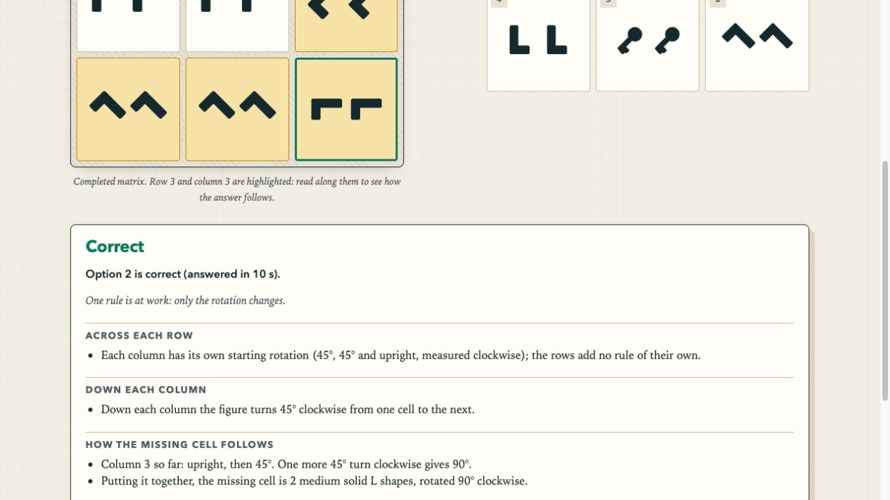

# Historical replay follow-up — 2026-10-27

| Severity | Reproduction | Fix | Status |
|---|---|---|---|
| P1 | `rotation`, difficulty 1, seed `audit-185`: the pre-audit fixture has answer **2**, “2 medium solid L shapes, rotated 90° clockwise”; the current engine produces answer **3**, “one medium solid key, rotated 45° clockwise”. Previously, `#/review/<id>`, timed summaries and mock/challenge reports regenerated the seed and displayed today's question against yesterday's selection. | Version-1 question snapshots; historical paths never invoke the generator. Original cells, option order, answer, explanation, hints and accessible descriptions are retained. | Fixed; actual historical fixture is a regression. |
| P2 | An unfinished seed-only session loaded after an engine change could continue with different questions, grade a changed answer key or assign timeouts to replacements. | Stop unsafe sessions before grading/catch-up, preserve recorded answers/results and staircase, label the reason. Pending legacy mock attempts use recorded metadata. | Fixed; storage and state regressions cover timed, mock and challenge. |
| P2 | A saved partition variant ID or dot element ID still depended on current engine geometry tables. | Snapshot partition lines and dot-element positions; render those stored values. | Fixed; test mutates both engine tables and proves saved drawings do not change. |

## Contract and limits

New attempts and mistakes contain snapshots. Fixed mock/timed tests capture every question at creation;
adaptive challenges capture each question when its level is assigned. Future, unassigned adaptive slots
may use a newer engine because they are not historical questions yet. Content-derived IDs distinguish
changed questions at the same seed, so a new mistake does not overwrite a different historical question.

Snapshots are detached JSON data with an explicit version and accidental-corruption checksum. They
include original rule parameters and generated prose, not handwritten replacements. Unsupported versions,
damaged payloads and metadata mismatches refuse replay. Unknown/retired families still replay from their
saved data. The current engine is not used to revalidate or re-mark an old question; a historical question
can therefore retain a flaw discovered later. Its recorded answer is the historical answer key.

Seed-only records cannot be upgraded honestly without the original payload or original engine revision.
They retain their existing result and selected/answer indices where available, with an explicit notice.
The app does not invent a snapshot from today's generator. Finished history remains finished; active
legacy sessions are ended with `endedBy: 'unavailable'` and a persisted end time.

Version 1 remains a rendering/data compatibility contract. Future incompatible rendering or schema
changes need a new version plus a compatible reader; they must not redefine the meaning of saved
version-1 cells. Browser storage is still finite and can be cleared or denied. Snapshots take more space;
existing retention caps apply and write failures produce a visible warning and memory-only fallback.
There is still no atomic transaction across attempts, mistakes and separate session-history keys.

## Verification

* `npm test`: **368 passing tests**, including **12 new replay regressions**.
* Snapshot round trips cover **29 families × 6 levels = 174 generated questions**; payload, shuffled
  options, answer, hints, distractor notes, descriptions and explanations are compared after JSON reload.
* The historical fixture test uses the real pre-audit question, not a made-up seed collision. It checks
  its original answer is still marked correct, detached copies cannot mutate history, and different
  content at the same seed gets a different saved identity.
* Legacy, unsupported and damaged snapshots are checked; fixed/adaptive assignment, session persistence,
  refusal of unsafe resumes, retained legacy mock results, retired families and unavailable UI are covered.
* `node tools/qa-report.js 200`: **27,600 agree; 0 ambiguous; 0 disagreements; 0 SVG duplicates; 0 text issues**.
  The regenerated report is `review/qa-report.md`. Generator and solver rules were not changed.
* Chromium on an isolated localhost origin: opened the historical snapshot, reloaded, selected option 2
  and submitted; the original L-shape question and explanation remained and feedback said “Correct”.
  Opened a legacy mistake and unfinished legacy timed/mock/challenge routes; they showed retained
  results and explicit unavailability. Reloading the archived challenge retained that state and zero
  fabricated timeouts. Temporary fixture page and server were removed after verification.

